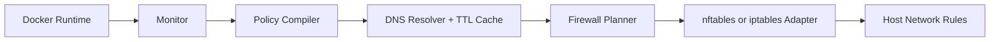

# Portcullis

[](https://github.com/nikarh/portcullis/actions/workflows/ci.yml)
[](https://crates.io/crates/portcullis)
[](https://docs.rs/portcullis)
[](LICENSE-MIT)
[](LICENSE-APACHE)

Host-level egress policy controller for Docker containers.

Portcullis reads container labels, compiles egress allowlists, resolves hostname targets with a bounded TTL cache, and applies firewall policy using `nftables` or `iptables`.

## Why
Container workloads usually have broad outbound access by default. Portcullis enforces least-privilege egress so containers can only reach explicitly allowed destinations.

## Current Status
Prototype implementation in Rust.

Implemented:
- Docker container/network discovery from labels and runtime metadata.
- Label-based egress policy parsing (`ip/cidr + ports`, `host + ports`).
- ICC allowlist parsing (`container|name|alias + ports`) in `allow-listed` mode.
- DNS resolution cache with TTL + max size + eviction.
- Firewall backends:
- `nftables` via `libnftables`
- `nftables` via CLI runner
- `iptables` adapter (uses `iptables` + `ipset`)
- Runtime backend auto-selection from Docker info:
- Docker reports `nftables` => use nftables (lib backend)
- Docker reports `iptables` => use iptables backend
- Long-running daemon mode:
- Startup cleanup to recover from unclean previous exits.
- Continuous Docker container event subscription over Docker Unix socket and policy re-apply on relevant events.
- Graceful cleanup on shutdown (SIGINT/SIGTERM via signal handler).
- Structured logging with `info` / `debug` / `trace` levels.

## Architecture

### High-level flow


### Runtime components
- `monitor`: Docker discovery via Docker Engine HTTP API over Unix socket (`/containers/json`, `/containers/{id}/json`, `/networks/{id}`, `/info`).
- `labels`: policy parsing from `portcullis.*` labels.
- `dns`: bounded hostname->IP cache (TTL + max-size eviction).
- `firewall`: backend adapters for nftables and iptables.

## How It Works
1. On startup, detect firewall backend and run cleanup of managed rules/chains/tables.
2. Collect container metadata and labels from Docker.
3. Parse labels into normalized egress rules.
4. Resolve hostname targets and cache resulting IPs.
5. Generate backend-specific firewall operations.
6. Apply default-deny egress plus explicit allow rules.
7. Enter event loop and refresh policy when relevant Docker container events arrive.
8. On shutdown, attempt cleanup of managed rules/chains/tables.

## Quick Start

### Build
```bash
cargo build --release
```

### Run
```bash
./target/release/portcullis \
  --docker-socket /var/run/docker.sock \
  --firewall-backend auto \
  --log-level info
```

## CLI
```text
portcullis [--docker-socket <path>] [--firewall-backend <auto|nftables|iptables>] [--log-level <error|warn|info|debug|trace>]
```

Options:
- `--docker-socket`: Docker Unix socket path. Default: `/var/run/docker.sock`
- `--firewall-backend`: `auto`, `nftables`, or `iptables`. Default: `auto`
- `--log-level`: `error|warn|info|debug|trace`. Default: `info`

## Labels

Prefix: `portcullis.*`

- Enable policy:
```text
portcullis.enable=true
```

- Static target:
```text
portcullis.egress.0=ip:1.1.1.1/32,tcp:443
```

- Hostname target:
```text
portcullis.egress.1=host:api.example.com,tcp:443
```

- ICC mode:
```text
portcullis.icc.mode=allow|deny|allow-listed
```

- ICC allowlist entry (used when `icc.mode=allow-listed`):
```text
portcullis.icc.allow.0=container:db,tcp:5432
```

ICC target lookup notes:
- `container:<value>` is resolved from Docker runtime metadata, not DNS.
- `<value>` can be container ID, container name, or network alias.

## Docker Compose Examples

### HTTPS-only egress
```yaml
services:
  app:
    image: ghcr.io/acme/app:latest
    labels:
      - "portcullis.enable=true"
      - "portcullis.egress.0=ip:1.1.1.1/32,tcp:443"
```

### Hostname allowlist + DNS
```yaml
services:
  api-client:
    image: ghcr.io/acme/client:latest
    labels:
      - "portcullis.enable=true"
      - "portcullis.egress.0=host:api.stripe.com,tcp:443"
      - "portcullis.egress.1=ip:10.96.0.10/32,udp:53"
```

### ICC deny mode
```yaml
services:
  internal-service:
    image: ghcr.io/acme/internal:latest
    labels:
      - "portcullis.enable=true"
      - "portcullis.icc.mode=deny"
      - "portcullis.egress.0=host:telemetry.acme.io,tcp:443"
```

### ICC allowlist by alias
```yaml
services:
  api:
    image: ghcr.io/acme/api:latest
    labels:
      - "portcullis.enable=true"
      - "portcullis.icc.mode=allow-listed"
      - "portcullis.icc.allow.0=container:db,tcp:5432"
      - "portcullis.icc.allow.1=container:redis,tcp:6379"

  db:
    image: postgres:16
    networks:
      default:
        aliases: [db]

  redis:
    image: redis:7
    networks:
      default:
        aliases: [redis]
```

## Logging
- `info`: operational lifecycle activity (startup cleanup, snapshot/apply, backend selection, event-triggered refresh)
- `debug`: runtime change details
- `trace`: exact firewall command arrays executed and full event/snapshot payloads

## DNS Cache Notes
- Cache stores hostname -> `Arc<[IpAddr]>`.
- TTL expiration and max-size eviction prevent unbounded growth.
- Cache hits return cached addresses without re-resolving.

## Limitations
- Prototype quality, not fully production hardened.
- DNS path currently resolver-driven (not a full packet-level DNS proxy listener yet).
- Backend behavior differences can exist between `nftables` and `iptables` edge cases.

## License
Licensed under either of:
- Apache License, Version 2.0 ([LICENSE-APACHE](LICENSE-APACHE))
- MIT license ([LICENSE-MIT](LICENSE-MIT))

at your option.

## Documentation
Detailed technical docs are in:
- `docs/PORTCULLIS.md`
